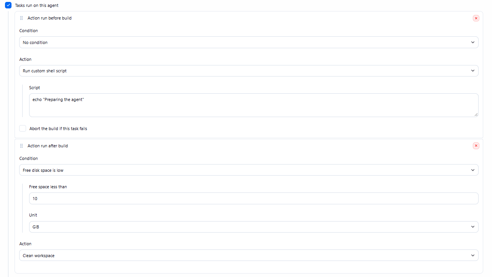
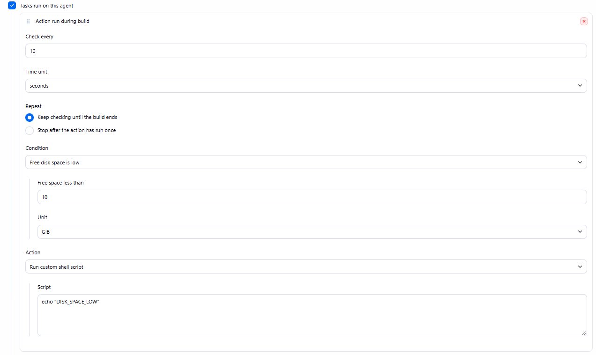
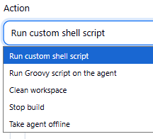
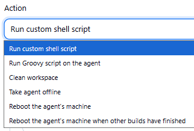

# Run Tasks on Agent

## Introduction

Run administrative, maintenance, setup or cleanup tasks on a specific agent every time it executes a build,
whatever the build is.

Other plugins usually define such tasks as build steps, so they belong to a job and run wherever that job runs.
This plugin takes the opposite approach: tasks are configured on the **agent** and run around **every build** on that
agent, before, during or after it, optionally only when a condition holds.

Typical uses:

* clean the workspace after a build when the agent is running out of disk space,
* reboot the machine after each build, e.g. when testing kernels on real hardware,
* take the agent offline after several failed builds in a row,
* prepare or check the environment before a build starts.

## Getting started

1. Go to *Manage Jenkins → Nodes → (your agent) → Configure*.
2. In the section *Tasks run on this agent*, click *Add* and choose when the task runs: before, during or after
   the build.
3. Choose a **condition** and an **action**, then save.



## Phases

* **Before the build:** runs before the build gets its workspace, so scripts run in the agent's root directory.
  With *Abort the build if this task fails* checked, a failing task stops the build and marks it as failed.
* **During the build:** the condition is checked every *Check every* interval, the first time one interval after
  the build starts. With *Stop after the action has run once*, the action runs at most once per build.
* **After the build:** runs after every build, including failed and aborted ones. A failing task is only reported
  in the build log, it does not change the build result.

## Conditions

| Condition | Parameters | Holds when | Before | During | After |
|---|---|---|:---:|:---:|:---:|
| No condition | | always | ✓ | ✓ | ✓ |
| Script exits with code 0 | shell script | the script, run on the agent, exits with code 0 | ✓ | ✓ | ✓ |
| Free disk space is low | size, MiB or GiB | the free space in the agent's root directory is below the size | ✓ | ✓ | ✓ |
| The last builds on this agent all failed | number of builds | the last N finished Freestyle builds on the agent, of any job, all failed | ✓ | ✓ | ✓ |
| Average duration of the last builds on this agent | number of builds, longer or shorter, duration | the average duration of the last N finished Freestyle builds on the agent is longer or shorter than the duration | ✓ | ✓ | ✓ |
| Result of the build | results (success, failure, aborted, unstable, not built) | the build ended with one of the checked results | | | ✓ |
| Duration of the build | longer or shorter, duration | the build (in Pipeline: the `node` block) took longer or shorter than the duration | | | ✓ |

## Actions

| Action | Parameters | What it does | Before | During | After |
|---|---|---|:---:|:---:|:---:|
| Run custom shell script | shell script | runs the script on the agent; a non-zero exit code means the task failed | ✓ | ✓ | ✓ |
| Run Groovy script on the agent | Groovy script | runs the script in the agent's JVM, its output goes to the build log; refused on the built-in node, whose JVM is the controller | ✓ | ✓ | ✓ |
| Take agent offline | | the agent accepts no new builds until it is brought back online | ✓ | ✓ | ✓ |
| Stop build | | aborts the build | ✓ | ✓ | |
| Clean workspace | | empties the build's workspace (before the build: the one the job's previous build left) | ✓ | | ✓ |
| Reboot the agent's machine | reboot command (optional) | takes the agent offline, reboots the machine and waits for the agent to connect again | | | ✓ |
| Reboot the agent's machine when other builds have finished | reboot command (optional) | like the previous one, but first waits for the other builds on the agent to finish | | | ✓ |

Shell scripts (the action and the condition) run like the *Execute shell* build step (`sh -xe` on Unix, `cmd` on Windows).



The form only offers the conditions and actions that make sense in the chosen phase:

| Before the build | After the build |
|---|---|
|  |  |

## Build log

The output of the tasks is written to the build log, together with whether each condition was met. Every line
starts with the agent and executor the task ran on, e.g. `[linux#0]` for the first executor of the agent `linux`:

```text
[linux#0] PRE_BUILD: condition 'No condition' met
[linux#0] PRE_BUILD: running 'Run custom shell script'
[linux#0] + echo Preparing the agent
[linux#0] Preparing the agent
[linux#0] PRE_BUILD: 'Run custom shell script' finished
Building remotely on linux in workspace /home/jenkins/agent/workspace/example-job
[example-job] $ /bin/sh -xe /tmp/jenkins13801513183852042390.sh
+ sleep 5
[linux#0] POST_BUILD: condition 'Free disk space is low' not met, skipping 'Clean workspace'
Finished: SUCCESS
```

## Pipeline

In Pipeline builds the tasks run around every `node` block, so `parallel` branches on different agents each run
that agent's tasks. In Declarative Pipeline they run around every stage with its own `agent`:

```groovy
pipeline {
    agent none
    stages {
        stage('Build') {
            agent { label 'linux' }   // tasks run before and after this stage
            steps {
                sh 'echo Building'
            }
        }
    }
}
```

```text
[Pipeline] node
[linux#0] PRE_BUILD: condition 'No condition' met
[linux#0] PRE_BUILD: running 'Run custom shell script'
[linux#0] + echo Preparing the agent
[linux#0] Preparing the agent
[linux#0] PRE_BUILD: 'Run custom shell script' finished
Running on linux in /home/jenkins/agent/workspace/example-pipeline
[Pipeline] {
[Pipeline] sh
+ echo Building
Building
[Pipeline] }
[linux#0] POST_BUILD: condition 'Free disk space is low' not met, skipping 'Clean workspace'
[Pipeline] // node
```

## Rebooting agents

The reboot actions restart the whole machine, not only the agent process. The default command is
`shutdown -r now` (Linux, macOS) or `shutdown -r -f -t 0` (Windows) and can be changed in the form. The user
running the agent must be allowed to run it.

The agent has to connect again by itself after the machine starts, e.g. as a system service. The plugin waits
up to 10 minutes for the agent to come back online. *Reboot the agent's machine when other builds have finished*
first waits up to 30 minutes for the other builds on the agent.

## Known limitations

* Tested on Linux agents only, Windows agents are not tested.
* In Pipeline builds the tasks after a `node` block run while the Pipeline already continues.
* In Pipeline builds *Result of the build* is never met, the result of a `node` block is not known yet.
* In Pipeline builds the workspace of a `node` block is not known: scripts run in the agent's root directory and
  *Clean workspace* does nothing.
* *The last builds on this agent …* conditions only count Freestyle builds.
* An error in a Groovy script is only printed to the build log, the task does not count as failed.
* When the controller restarts during a Pipeline build, the tasks before the `node` block run again.

## Security

* Tasks can be configured by users with the *Agent/Configure* permission on the agent. Tasks on the built-in node
  can only be configured by administrators.
* Scripts and other actions run on the agent as the operating system user running the agent, like build steps do.
* *Run Groovy script on the agent* does not run on the built-in node: there it would run inside the Jenkins controller
  with full control of Jenkins.

## Extending

Other plugins can add their own conditions and actions. Subclass `Condition` (or `Action`) and register a
descriptor; it then appears in the dropdown. Override `isApplicable(Phase)` in the descriptor to offer it only in
some phases:

```java
public class WeekendCondition extends Condition {

    @DataBoundConstructor
    public WeekendCondition() {}

    @Override
    public boolean conditionPasses(TaskContext context) {
        DayOfWeek day = LocalDate.now().getDayOfWeek();
        return day == DayOfWeek.SATURDAY || day == DayOfWeek.SUNDAY;
    }

    @Extension
    public static final class DescriptorImpl extends TaskDescriptor<Condition> {
        @Override
        public String getDisplayName() {
            return "It is the weekend";
        }

        @Override
        public boolean isApplicable(Phase phase) {
            return phase == Phase.PRE_BUILD;
        }
    }
}
```

`TaskContext` gives access to the build, the agent, a launcher, the build log and the workspace.

## Changelog

See [GitHub Releases](https://github.com/jenkinsci/run-tasks-on-agent-plugin/releases).

## Issues

Report issues and enhancements in [GitHub Issues](https://github.com/jenkinsci/run-tasks-on-agent-plugin/issues).

## Contributing

Refer to our [contribution guidelines](https://github.com/jenkinsci/.github/blob/master/CONTRIBUTING.md).

## License

Licensed under MIT, see [LICENSE](LICENSE.md).

Based on the ideas of the [Jenkins Agent Manager](https://github.com/skobyda/jenkins-agent-manager) plugin by Simon Kobyda.

Parts of this plugin were developed with the help of an AI coding assistant (Claude Code). All code was reviewed,
tested and is maintained by the author, who takes full responsibility for it.
